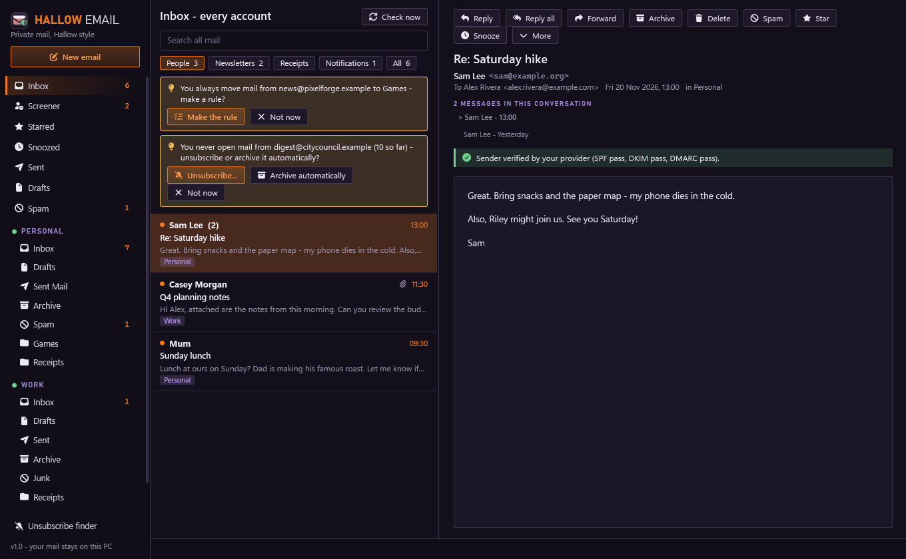
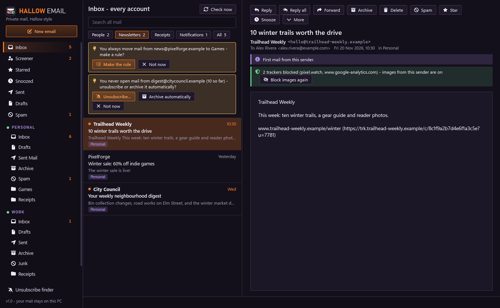
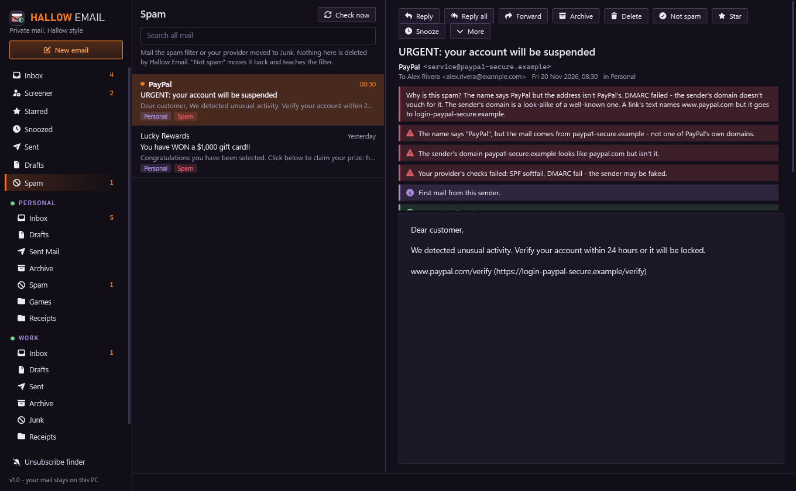
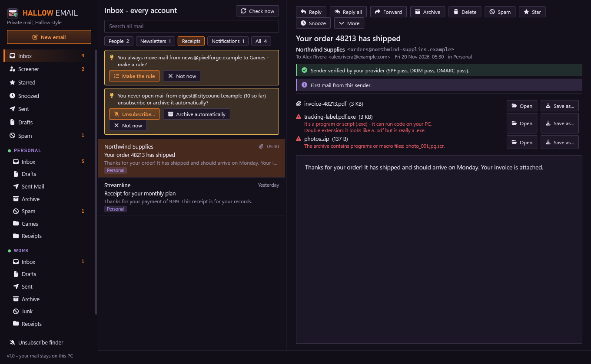
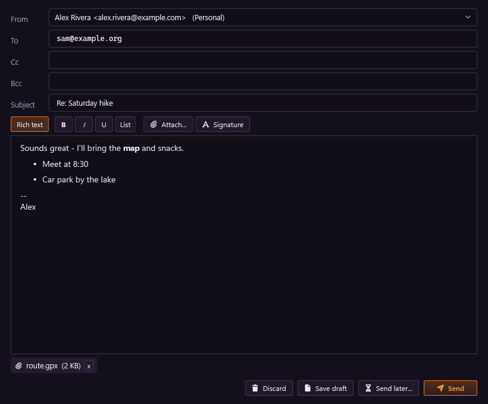
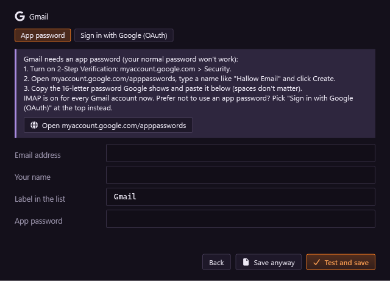
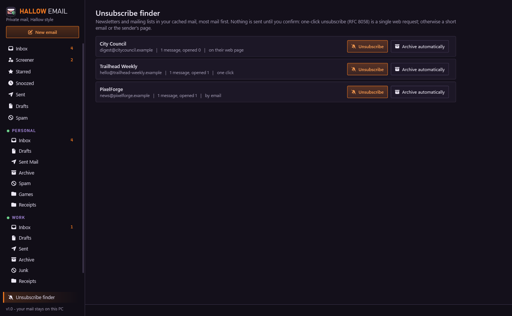
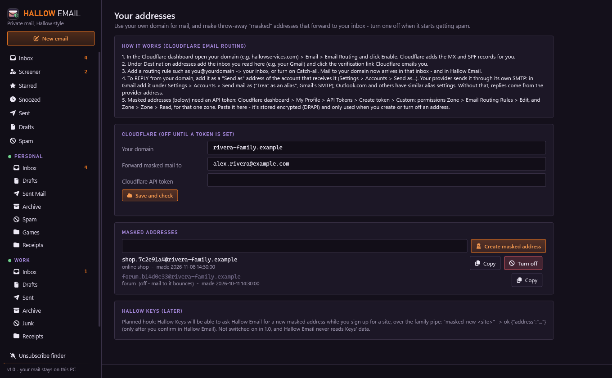
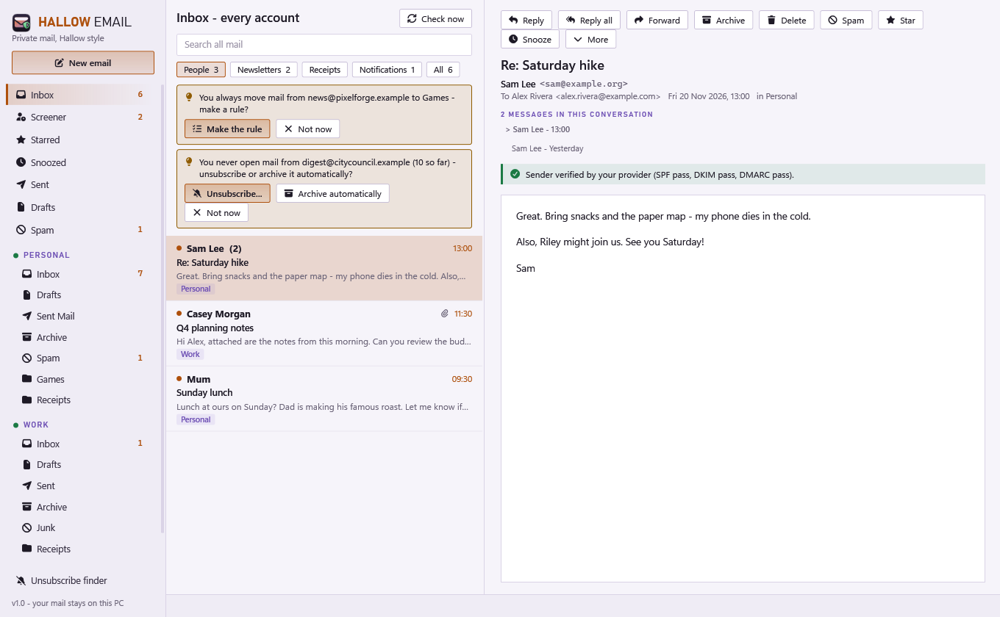

# Hallow Email

**A private desktop email client, Hallow style.**

Part of the Hallow family of Windows apps. Hallow Email reads your IMAP accounts (Gmail, Outlook / Hotmail, Yahoo, iCloud or any
provider) in **one inbox sorted into People, Newsletters, Receipts and Notifications**, keeps an **encrypted** copy on your PC for
fast search, blocks **remote images and trackers**, warns about **phishing** and risky **attachments**, filters **spam** privately
on your PC, and lets you **unsubscribe** in one click. No company server, no cloud account, no telemetry: your PC talks only to your
own mail servers (and Cloudflare, if you set up masked addresses). Light and dark mode.

## What it does

- **Accounts**: IMAP + SMTP with **app passwords**. Presets for Gmail, Outlook / Hotmail, Yahoo and iCloud (servers and ports filled
  in, step-by-step help for making the app password), plus any other provider (custom servers, SSL/TLS or STARTTLS). "Test and save"
  signs in to IMAP and SMTP first. **OAuth** (optional) for Gmail and Microsoft with a client ID **you** register - the wizard shows
  how; sign-in happens in your own browser (PKCE, a one-time 127.0.0.1 redirect) and only the refresh token is kept, encrypted.
- **Unified inbox** across accounts with tabs **People / Newsletters / Receipts / Notifications / All** (from List-Unsubscribe,
  List-Id, Precedence, Auto-Submitted, sender patterns and subject words; right-click > "Always show this sender in ..." to move a
  sender or a whole domain), each account's **folders**, **conversations** (Message-ID / In-Reply-To / References, then the subject),
  Starred, Snoozed, Sent, Drafts, Spam and the Outbox.
- **Fast, encrypted local cache**: summaries, a text copy of each body for search, and the messages you opened or that were
  pre-fetched - AES-256 + HMAC with a key protected by Windows DPAPI (only your Windows user on this PC can open it).
  **Search** across every account: words, `from:`, `to:`, `subject:`, `has:attachment`, `is:unread`, `is:starred`, `label:`, "quoted phrases".
- **Push**: IMAP **IDLE** on each inbox - new mail appears at once; other folders are checked every 5 minutes.
- **Privacy**: every HTML mail is rebuilt token by token (MimeKit's HTML tokenizer) without scripts, frames, forms, event handlers,
  `javascript:` links, `<base>`, meta refresh or remote CSS. **Remote images are blocked by default**; "Load images from this sender"
  allows them (https only) - **tracking pixels stay blocked even then**: 1x1 / hidden images, known tracking hosts (**Hallow Shield's
  lists** - EasyPrivacy, Peter Lowe's - read from Hallow Browser's built-in Shield when it's on this PC, plus a short built-in list)
  and image URLs carrying a unique ID. Every link shows its **real destination** on hover, and a visible warning when the link text
  names a different site. The reader is a locked-down **Microsoft Edge WebView2**: scripts off, every network request refused unless
  allowed, links never open inside it (a click asks, then opens your browser), downloads and permissions refused. Or "Always show
  mail as plain text".
- **Safety**: **phishing hints** - a brand in the display name ("PayPal") from a domain that isn't the brand's, an address in the
  name that isn't the sender, **look-alike domains** (punycode, rn/m, 0/o, 1/l, swapped letters, brand + "secure"...), your
  provider's **SPF / DKIM / DMARC** results (Authentication-Results), Reply-To to another domain, and a "first mail from this sender"
  note. **Attachments** are flagged (programs and scripts, Office macros, double extensions like `invoice.pdf.exe`, right-to-left
  tricks, disk images, archives containing programs) and **scanned with Microsoft Defender** (MpCmdRun, at Idle priority) before
  they open - anything that isn't clean isn't opened.
- **Private spam filter**: a learning (naive Bayes, Robinson / Fisher) filter that starts from a small made-up seed corpus and learns
  from your **Spam / Not spam** clicks, plus rule signals with reasons: your provider's spam headers, SPF / DKIM / DMARC failures,
  brand / look-alike senders, link text vs destination, URL shorteners, image-only mail, spam wording, first-time sender + urgency,
  Hallow Shield's badware hosts. Spam is **moved to the account's Junk folder** (so it syncs) with **"Why is this spam?"** -
  never deleted. People you've written to are never marked as spam. Sensitivity Low / Normal / High per account.
- **Sorting help**: **rules** (sender / subject / to / list / attachment -> move to a folder, label, mark read, star, skip the inbox,
  show in a tab, notify), "Create rule from this email", **suggestions** ("You always move mail from X to Y - make a rule?", "You
  never open these newsletters - unsubscribe or archive automatically?"), **labels** (kept locally and as IMAP keywords where the
  server allows), the **Screener** (first-time senders wait until you let them in; screened-out senders are archived quietly) and
  **bulk actions** (select all from a sender > archive / delete to Trash / move).
- **Unsubscribe finder**: newsletters by volume with how often you opened them; **one-click unsubscribe** (RFC 8058
  List-Unsubscribe-Post) or the mailto / web link - always after you confirm, and a rule archives anything that still comes.
- **Writing**: rich text or plain, attachments, a **signature** per account, **Send as** addresses, **drafts saved to the server**,
  **Undo send** (10 s by default, 0-30 s), **Send later** and **Snooze** (both wait on this PC - Hallow Email has to be running
  then; anything overdue goes out when it starts), an Outbox that keeps and retries failed sends.
- **Your own domain and masked addresses**: how to use **Cloudflare Email Routing** for your domain (e.g. hallowservices.com):
  forwarding to your inbox, and replying "as" your domain through your provider's SMTP. **Masked addresses** (`shop.7c2e91a4@yourdomain`)
  are created and turned off through the Cloudflare API with a token **you** create (Email Routing Rules: Edit) - off until it's set,
  stored encrypted.
- **Hallow family**: the family pipe, status.json, Hallow Hub's tray icon, quiet notes for new mail from People (through Hub;
  never while a game runs unless you switch it on), the Hallow accent, light / dark, crash reports kept on this PC, updates from
  GitHub with a checksum check.

| | |
|---|---|
|  |  |
|  |  |
|  |  |
|  |  |

## Install

1. Download **Hallow.Email.zip** from [Releases](https://github.com/Dom428/hallow-email/releases), right-click > Properties >
   **Unblock**, Extract All.
2. Double-click **INSTALL.bat** (no admin). It installs to `%LOCALAPPDATA%\Programs\Hallow Email`, with Start menu and Desktop
   shortcuts and an entry in Settings > Apps.
3. Open Hallow Email > **Add an account**.

Needs Windows 10/11 with .NET Framework 4.8 (built in) and, for HTML mail, the **Microsoft Edge WebView2 Runtime** (part of
Windows 11; without it mail is shown as plain text).

### What you need to do

- **Make an app password** for each account (your normal password won't work, and shouldn't be used):
  - Gmail: turn on 2-Step Verification, then myaccount.google.com/apppasswords.
  - Outlook / Hotmail: turn on two-step verification, then account.microsoft.com > Security > Advanced security options > App
    passwords. Microsoft is phasing out app passwords for IMAP on personal accounts - if it's refused, use OAuth.
  - Yahoo: Account security > Generate app password. iCloud: account.apple.com > Sign-In and Security > App-Specific Passwords.
- **OAuth instead (optional)**: register your own app - Google Cloud console (OAuth client ID, type Desktop app, scope
  `https://mail.google.com/`) or Microsoft Entra (public client, redirect `http://localhost`, delegated IMAP.AccessAsUser.All,
  SMTP.Send, offline_access) - and paste the client ID into the wizard.
- **Your own domain (optional)**: Cloudflare dashboard > your domain > Email > Email Routing > Enable, add and verify your inbox as
  a destination, add a rule (or catch-all). To reply from it, add it as a "Send as" address in your provider (e.g. Gmail >
  Settings > Accounts > Send mail as) and in Hallow Email (Settings > Accounts > Send as...). For **masked addresses**, create an
  API token (My Profile > API Tokens > Custom: Zone > Email Routing Rules > Edit, Zone > Zone > Read) and paste it on the
  "Your addresses" page.

## Privacy and data

- Data: `%APPDATA%\HallowEmail` - `settings.json` (look and switches only), `profile.bin` (accounts' server settings, rules, sender
  lists, the spam filter, snoozes, the Outbox - encrypted), `secrets.dat` (app passwords, refresh tokens, the Cloudflare token -
  DPAPI), `cache.key` (the cache key, DPAPI), `cache\<account>\` (the encrypted mail cache), `status.json`, `crashes\`. WebView2's
  own scratch folder: `%LOCALAPPDATA%\HallowEmail\WebView2` (no mail is kept there - mail is loaded from memory).
- Passwords and tokens are never logged, never in status or over the pipe, and scrubbed from crash reports.
- Network: only your IMAP / SMTP servers; Cloudflare's API when you create or turn off a masked address; one-click unsubscribe
  requests when you confirm one; GitHub for update checks; images you chose to load.
- "Forget this account" (Settings > Accounts > Remove) deletes its password and its cache on this PC; the mail on the server stays.

## Hallow family link

- Pipe `HallowFamily.Email.<user>` (this user only): `ping`, `status` (unread count per account - no subjects, senders or
  addresses), `open [inbox|people|newsletters|receipts|notifications|screener|spam|sent|drafts|unsubscribe|masked|rules|settings]`,
  `compose <address>` (opens a new email - never sends), `menu`, `invoke <id>`, `sync`, `quit`. `HallowEmail.exe --cmd "<line>"`
  prints the reply (exit 0 ok, 1 error, 2 not running). `HallowEmail.exe mailto:someone@example.com` opens a new email.
- `%APPDATA%\HallowEmail\status.json`: `{"app":"Email","version":"1.0","running":true,"accounts":[{"account":"Personal","unread":3,"state":"idle"}],"unread":3,"outbox":0,"snoozed":1,"screener":false,"spamFilter":true,"look":"dark","startsWithWindows":false,"lastCrash":null}`.
- Hallow Hub hosts the tray icon (`tray-host`) and shows the new-mail notes (`notify`).
- **Hallow Keys (later)**: a planned `masked-new <site>` pipe command so Keys can offer a fresh masked address while you sign up
  somewhere (only after you confirm in Hallow Email). Not in 1.0; Hallow Email never reads Keys' data.

## Build and test

`build.ps1` builds `HallowEmail.exe` with the C# compiler that ships with Windows (.NET Framework 4.8) against MailKit 5.0.0 /
MimeKit.Core 5.0.0 and the WebView2 SDK in `lib\` (versions, hashes and licences: [licenses/THIRD-PARTY.md](licenses/THIRD-PARTY.md)).
`build.ps1 -Tests` also builds `tests\EmailTests.exe`: 251 checks against **local stand-ins only** - a small IMAP4rev1 + SMTP server
on 127.0.0.1 (sync, IDLE push, folders, search, conversations, flags, moves, rules, the Screener, spam to Junk, drafts, Undo send,
Send later, retries, XOAUTH2), stand-in web endpoints for one-click unsubscribe, Cloudflare and the OAuth token endpoint, a stand-in
Microsoft Defender, the HTML / tracker / phishing / attachment fixtures, the spam filter on made-up ham and spam, cache encryption,
the light palette's contrast, the WebView2 sandbox in an off-screen window, and the family pipe of a headless test copy.
`HallowEmail.exe --snap <folder>` renders every window in dark and light with made-up mailboxes.

Font Awesome Free icons (CC BY 4.0). MailKit and MimeKit by Jeffrey Stedfast / .NET Foundation (MIT).
